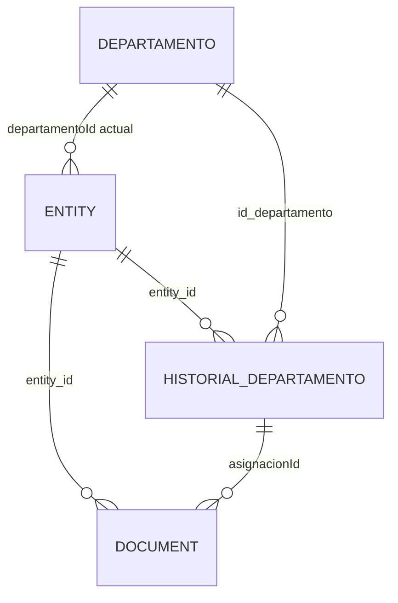

# Modelo de Datos — Incremento 002: RR. HH. e Historial de Productividad Laboral

**Funcionalidad:** `002-rrhh-productividad`  
**Rama:** `correccion-specs-002`  
**Fecha:** 2026-11-09  
**Especificación:** `specs/002-rrhh-productividad/spec.md`  
**MER de referencia:** `specs/001-erp-base-module/data-model.md`  
**Estado:** Modelo implementado y verificado; suite automatizada aprobada (14 archivos, 132 pruebas) y prueba técnica con 500 registros aprobada (T076). Pendientes las mediciones manuales SC-001 a SC-003, la evaluación de usuarios de SC-004 y la asignación de responsables.

## 1. Propósito y alcance

Este documento define el modelo de datos del incremento 002, correspondiente al módulo de Recursos Humanos e Historial de Productividad Laboral.

Se conserva el MER de nueve entidades documentado en el incremento 001, sin modificar sus entidades ni relaciones.

Para implementar las cuatro historias de usuario:

- Se reutiliza `Entity` para representar trabajadores.
- Se reutiliza `Document` para representar registros de productividad.
- Se implementa `Departamento`, entidad ya definida en el MER.
- Se implementa `Historial_Departamento`, entidad ya definida en el MER.
- Se utiliza `ModuleConfig` para adaptar las etiquetas y los campos personalizados.

Las entidades `Contrato`, `Liquidacion`, `Detalle_Liquidacion`, `Tarea`, `Registro_Horas` y `Meta` permanecen en el MER, pero no se implementan como flujos de negocio en 002.

No se crean entidades nuevas en el MER.

## 2. Referencias y estado de implementación

### 2.1. Código base histórico

Se revisó el código del commit `a0062c0^`, recuperable desde el historial de Git.

En ese código se verificaron:

- Las estructuras y validaciones principales de `Entity`.
- Las estructuras y validaciones principales de `Document`.
- La configuración mediante `ModuleConfig`.
- El almacenamiento mediante `localStorage`.
- Las claves `erp_base_module:entities` y `erp_base_module:documents`.
- Las operaciones de creación, edición y eliminación de entidades y documentos.
- La eliminación en cascada de documentos cuando se elimina una entidad.

El código base fue restaurado en el árbol de trabajo y las observaciones históricas se confirmaron durante la implementación.

### 2.2. Estructuras implementadas en 002

`Departamento` e `Historial_Departamento` están implementados en 002 con persistencia, validaciones y operaciones propias, sin alterar el MER.

Las claves y reglas se verifican en `src/storage.js` y en las pruebas automatizadas.

### 2.3. Decisiones aplicadas en 002

- Usar `Entity` como Trabajador.
- Usar `Document` como Registro de productividad.
- Generar automáticamente un folio entero positivo.
- Almacenar departamentos en `erp_base_module:departamentos`.
- Almacenar asignaciones en `erp_base_module:historial_departamentos`.
- Mantener las claves originales de trabajadores y documentos.
- Utilizar `documents` exclusivamente para productividad durante 002, después de verificar datos anteriores.
- No utilizar los campos monetarios de `Document`.
- Vincular cada medición con una asignación histórica mediante `asignacionId`.

Estas decisiones están implementadas y cubiertas por pruebas automatizadas.

## 3. Correspondencia con el MER 001

| Concepto de 002 | Estructura utilizada | Uso |
|---|---|---|
| Trabajador | `Entity` / Trabajador | Datos de trabajadores |
| Departamento | `Departamento` | Organización departamental |
| Asignación histórica | `Historial_Departamento` | Períodos de pertenencia |
| Registro de productividad | `Document` | Mediciones periódicas |
| Configuración | `ModuleConfig` | Etiquetas y campos personalizados |
| Contrato | `Contrato` | Fuera de alcance |
| Liquidación | `Liquidacion` | Fuera de alcance |
| Detalle de liquidación | `Detalle_Liquidacion` | Fuera de alcance |
| Tarea | `Tarea` | Fuera de alcance |
| Registro de horas | `Registro_Horas` | Fuera de alcance |
| Meta | `Meta` | Fuera de alcance |

El MER original conserva sus nueve entidades:

1. Departamento
2. Trabajador
3. Contrato
4. Liquidacion
5. Detalle_Liquidacion
6. Tarea
7. Registro_Horas
8. Meta
9. Historial_Departamento

`Entity`, `Document` y `ModuleConfig` corresponden a estructuras técnicas del ERP base y no se agregan como nuevas entidades al MER.

## 4. Diccionario de datos

### 4.1. Trabajador — Entity

Se reutiliza `Entity` para representar a cada trabajador.

#### Campos base

| Campo | Tipo | Obligatorio | Descripción |
|---|---|---|---|
| `id` | string | Sí | Identificador interno único |
| `entity_id` | string | Sí | Identificador público único e inmutable |
| `name` | string | Sí | Nombre del trabajador |
| `code` | string | Sí | Código interno |
| `taxId` | string | No | Identificación fiscal opcional |
| `email` | string | No | Correo electrónico |
| `phone` | string | No | Teléfono |
| `address` | string | No | Dirección |
| `category` | string | No | Clasificación |
| `description` | string | No | Observaciones |
| `targetDate` | string | No | Fecha opcional |
| `creditLimit` | number | No | Campo heredado del ERP |
| `paymentTerms` | string | No | Campo heredado del ERP |
| `createdAt` | string | Sí | Fecha de creación |
| `updatedAt` | string | Sí | Última actualización |

#### Campos personalizados de 002

| Campo | Tipo | Obligatorio | Descripción |
|---|---|---|---|
| `cargo` | text | Sí | Cargo del trabajador |
| `fechaIngreso` | date | Sí | Fecha de ingreso |
| `estadoLaboral` | select | Sí | Activo o Inactivo |
| `departamentoId` | text | Condicional | Departamento actual |

Reglas:

- `name` y `code` no pueden estar vacíos.
- `entity_id` se genera automáticamente y no se modifica.
- `fechaIngreso` utiliza el formato `YYYY-MM-DD`.
- `estadoLaboral` tiene como valor inicial propuesto `Activo`.
- `departamentoId` representa el departamento actual, no el histórico.
- Un cambio de departamento debe actualizar las asignaciones históricas.
- Un trabajador con historial no se elimina físicamente: se marca como `Inactivo`.
- `tipoContrato`, presente en el MER, no es obligatorio para 002.

### 4.2. Departamento

Entidad definida en el MER 001 que se implementará en 002.

| Campo | Tipo | Clave | Obligatorio |
|---|---|---|---|
| `id_departamento` | string | PK | Sí |
| `nombre` | string | — | Sí |
| `descripcion` | string | — | No |

Reglas:

- `id_departamento` identifica de manera única al departamento.
- `nombre` es obligatorio.
- No se permiten nombres duplicados después de normalizar espacios y mayúsculas/minúsculas.
- Un departamento con trabajadores o historial asociado no se elimina físicamente mientras no exista una política de conservación.
- Se almacena en `erp_base_module:departamentos`.

### 4.3. Historial_Departamento

Representa cada período durante el cual un trabajador pertenece a un departamento.

| Campo | Tipo | Clave | Obligatorio |
|---|---|---|---|
| `id_historial` | string | PK | Sí |
| `entity_id` | string | FK | Sí |
| `id_departamento` | string | FK | Sí |
| `fecha_inicio` | string | — | Sí |
| `fecha_fin` | string/null | — | No |

Relaciones:

- `entity_id` referencia `Entity.entity_id`.
- `id_departamento` referencia `Departamento.id_departamento`.

Reglas:

- Las fechas utilizan `YYYY-MM-DD`.
- `fecha_inicio` es obligatoria.
- `fecha_fin` puede ser nula cuando la asignación no tiene fecha de término; una fecha de inicio futura indica una asignación programada, no vigente.
- La asignación está vigente en la fecha actual solo si `fecha_inicio` es hoy o anterior y `fecha_fin` es nula o hoy o posterior.
- Si existe `fecha_fin`, debe ser igual o posterior a `fecha_inicio`.
- No se permiten asignaciones superpuestas para el mismo trabajador.
- Solo puede existir una asignación vigente por trabajador.
- Los cambios de departamento deben cerrar la asignación anterior y crear una nueva.
- Las asignaciones anteriores se conservan.
- Se almacena en `erp_base_module:historial_departamentos`.

#### Protección de asignaciones con mediciones asociadas

Si una asignación histórica tiene registros de productividad vinculados, no se podrán modificar sus fechas, trabajador o departamento de manera que esos registros pierdan su validez.

Antes de guardar una corrección de asignación se deberá verificar que:

1. Las mediciones vinculadas sigan perteneciendo al mismo trabajador.
2. Cada período de productividad continúe superponiéndose con la asignación.
3. No se produzcan superposiciones con otras asignaciones.
4. No queden referencias históricas inválidas.

Si una modificación incumple estas reglas, el sistema deberá rechazarla y explicar el motivo.

No se eliminarán asignaciones con mediciones vinculadas.

### 4.4. Registro de productividad — Document

Se reutiliza `Document` para almacenar las mediciones de productividad.

No se crea una entidad nueva.

#### Campos base

| Campo | Tipo | Obligatorio | Uso en 002 |
|---|---|---|---|
| `id` | string | Sí | Identificador interno |
| `entity_id` | string | Sí | Trabajador asociado |
| `series` | string | No | No utilizado |
| `folio` | integer | Sí | Correlativo automático |
| `startDate` | string | Sí | Primer día del mes |
| `endDate` | string | Sí | Último día del mes |
| `quantity` | number | No | No utilizado |
| `subtotal` | number | No | No utilizado |
| `discount` | number | No | No utilizado |
| `taxAmount` | number | No | No utilizado |
| `totalAmount` | number | No | No utilizado |
| `currency` | string | No | No utilizado |
| `paymentTerms` | string | No | No utilizado |
| `notes` | string | No | Opcional |
| `status` | string | No | Sin ciclo obligatorio |
| `createdAt` | string | Sí | Fecha de creación |
| `updatedAt` | string | Sí | Última actualización |

#### Campos personalizados de productividad

| Campo | Tipo | Obligatorio | Descripción |
|---|---|---|---|
| `indicador` | text | Sí | Indicador medido |
| `resultado` | number | Sí | Resultado numérico |
| `unidad` | text | Sí | Unidad de medida |
| `asignacionId` | text | Sí | Identificador de asignación histórica |

#### Relación de asignacionId

`Document.asignacionId` referencia:

`Historial_Departamento.id_historial`

No referencia directamente al departamento ni al trabajador.

La asignación debe:

- Existir.
- Pertenecer al mismo `entity_id` del documento.
- Superponerse con el período registrado.

`asignacionId` siempre debe estar presente en el registro guardado.

Cuando existe una sola asignación válida para el mes, la aplicación puede seleccionarla automáticamente. Si existen varias, el usuario debe elegir una explícitamente.

#### Reglas de productividad

- El período se representa con el primer y último día del mes.
- Se muestra al usuario como `AAAA-MM`.
- No se permiten períodos futuros.
- No se permiten períodos anteriores al ingreso del trabajador.
- `indicador` debe tener entre 3 y 60 caracteres.
- `resultado` debe ser numérico y mayor o igual a cero.
- `unidad` es obligatoria.
- El trabajador debe existir.
- La asignación debe existir y corresponder al trabajador.
- No se permite registrar productividad sin una asignación válida.
- Los duplicados del mismo trabajador, período e indicador se permiten con advertencia.
- Una corrección solo modifica el registro seleccionado.
- El folio no cambia durante una corrección.
- Los campos monetarios no utilizados se omiten.
- No se crean liquidaciones en 002.

### 4.5. ModuleConfig

`ModuleConfig` permite configurar el módulo ERP sin crear una entidad adicional.

| Campo | Tipo | Uso |
|---|---|---|
| `moduleName` | string | Nombre del módulo |
| `labels` | object | Etiquetas visibles |
| `customFields` | array | Campos personalizados |
| `statusLifecycle` | object/null | Ciclo de estados opcional |
| `theme` | object | Configuración visual |

Configuración propuesta:

- `moduleName`: RR. HH. e Historial de Productividad.
- `labels.entity`: Trabajador.
- `labels.entities`: Trabajadores.
- `labels.document`: Registro de Productividad.
- `labels.documents`: Registros de Productividad.

Campos personalizados para `entity`:

- `cargo`
- `fechaIngreso`
- `estadoLaboral`
- `departamentoId`

Campos personalizados para `document`:

- `indicador`
- `resultado`
- `unidad`
- `asignacionId`

Los campos personalizados deben usar tipos admitidos por el ERP base y no pueden coincidir con nombres de campos base.

`statusLifecycle` no es obligatorio para 002.

## 5. Relaciones y cardinalidades

| Relación | Cardinalidad | Implementación |
|---|---|---|
| Departamento → Trabajador actual | 1:N | `Entity.departamentoId` |
| Trabajador → Historial_Departamento | 1:N | `Historial_Departamento.entity_id` |
| Departamento → Historial_Departamento | 1:N | `Historial_Departamento.id_departamento` |
| Trabajador → Document | 1:N | `Document.entity_id` |
| Historial_Departamento → Document | 1:N | `Document.asignacionId` |
| Departamento → Document | 1:N indirecta | Mediante `Historial_Departamento` |

### 5.1. Diagrama lógico

Este diagrama representa las estructuras utilizadas por 002 y no reemplaza el MER original de nueve entidades.

### 5.2. Integridad referencial

- Todo registro de productividad debe referenciar un trabajador existente.
- Toda medición debe referenciar una asignación histórica existente.
- La asignación debe pertenecer al mismo trabajador.
- La asignación debe superponerse con el período de la medición.
- El departamento histórico se obtiene desde la asignación.
- No se almacena una referencia directa adicional al departamento en `Document`.
- No se permiten referencias huérfanas.
- No se eliminan trabajadores o asignaciones con mediciones vinculadas.

## 6. Validaciones

### 6.1. Trabajador

- Nombre obligatorio.
- Código obligatorio.
- Identificador único e inmutable.
- Fecha de ingreso válida.
- Estado laboral válido.
- Departamento actual existente cuando se indique.
- Campos personalizados compatibles con `ModuleConfig`.

### 6.2. Departamento

- Nombre obligatorio.
- Nombre único normalizado.
- Identificador único.
- Eliminación bloqueada cuando existan relaciones históricas.

### 6.3. Asignación histórica

- Trabajador existente.
- Departamento existente.
- Fecha de inicio válida.
- Fecha de término opcional.
- Fecha de término no anterior al inicio.
- Sin superposición de asignaciones para el mismo trabajador.
- Máximo una asignación vigente por trabajador.
- Protección de asignaciones que ya tienen mediciones asociadas.

### 6.4. Productividad

- Trabajador existente.
- Asignación válida.
- Período mensual válido.
- Período no futuro.
- Período no anterior al ingreso.
- Indicador entre 3 y 60 caracteres.
- Resultado numérico no negativo.
- Unidad obligatoria.
- Folio entero positivo.
- Advertencia ante duplicados.
- Corrección limitada al registro seleccionado.

### 6.5. Casos especiales

| Situación | Comportamiento |
|---|---|
| Trabajador sin asignación | Impedir registro de productividad |
| Cambio de departamento durante un mes | Solicitar selección de asignación cuando haya varias |
| Período futuro | Rechazar |
| Período anterior al ingreso | Rechazar |
| Registro duplicado | Advertir y permitir confirmar |
| Trabajador sin mediciones | Mostrar mensaje informativo |
| Datos insuficientes | Informar falta de datos |
| Indicadores diferentes | No compararlos como equivalentes |
| Unidades diferentes | No compararlas como equivalentes |
| Eliminación de trabajador con historial | Bloquear eliminación física |
| Eliminación de departamento con historial | Bloquear eliminación física |
| Edición que invalida mediciones históricas | Rechazar modificación |
| Error de almacenamiento | Informar que no se guardó |

## 7. Persistencia en localStorage

### 7.1. Claves de almacenamiento

| Clave | Contenido | Estado |
|---|---|---|
| `erp_base_module:entities` | Trabajadores | Confirmada en código histórico |
| `erp_base_module:documents` | Registros de productividad | Clave existente; nuevo uso en 002 |
| `erp_base_module:departamentos` | Departamentos | Propuesta para 002 |
| `erp_base_module:historial_departamentos` | Asignaciones históricas | Propuesta para 002 |

### 7.2. Formato de almacenamiento

- Cada colección contiene un arreglo JSON.
- Los identificadores se almacenan como cadenas.
- Las fechas de negocio usan `YYYY-MM-DD`.
- Las marcas de tiempo usan formato ISO.
- Los campos personalizados se almacenan junto con los campos base, según el mecanismo del ERP.
- Los campos monetarios no utilizados se omiten.

### 7.3. Reutilización de documents

El ERP base utiliza la colección `erp_base_module:documents`.

En el incremento 002 se utiliza exclusivamente para registros de productividad.

Reglas aplicadas:

1. Verificar el contenido existente.
2. Identificar documentos que no correspondan al esquema de productividad.
3. No eliminar datos anteriores silenciosamente.
4. Definir una estrategia de respaldo, migración o limpieza con confirmación.
5. Evitar interpretar liquidaciones como registros de productividad.

Si en una versión futura deben coexistir productividad y liquidaciones, será necesario implementar un discriminador de tipo o colecciones separadas y documentar la migración correspondiente.

### 7.4. Generación automática de folio

- El folio se genera al crear un registro.
- Se calcula como el mayor folio válido existente más uno.
- Si no existen registros, el primer folio será `1`.
- Debe ser entero positivo.
- No se solicita al usuario.
- No cambia al editar un registro.
- Los datos anteriores con folios inválidos deben tratarse antes de reutilizar la colección.

### 7.5. Protección frente a eliminación en cascada

El código histórico del ERP base contempla la eliminación de documentos asociados cuando se elimina una entidad.

Ese comportamiento no debe provocar pérdida accidental del historial laboral.

Por lo tanto:

- La interfaz de 002 debe impedir la eliminación física de trabajadores con registros o asignaciones históricas.
- Debe ofrecer la opción de marcar al trabajador como `Inactivo`.
- Las operaciones de almacenamiento deben validar esta restricción antes de eliminar.
- No basta con ocultar el botón de eliminación: la operación debe estar protegida en la lógica.
- No se debe modificar el código central del ERP sin verificar previamente los mecanismos de extensión disponibles.

La protección se aplica en la lógica de almacenamiento: `deleteEntity` bloquea la eliminación física cuando existen documentos o asignaciones.

### 7.6. Errores de almacenamiento

Cuando `localStorage` esté lleno, bloqueado o no disponible:

- Se informa el error al usuario.
- No se muestra una confirmación falsa de guardado.
- No se promete recuperación automática.
- Se evita presentar información no persistida como si estuviera guardada.

El manejo de errores está implementado y cubierto por pruebas automatizadas. La aprobación del texto de la advertencia sobre datos ficticios queda pendiente del grupo (T072).

## 8. Consultas lógicas por historia de usuario

### 8.1. HU1 — Registrar productividad

**Entrada:**

- Trabajador
- Período
- Indicador
- Resultado
- Unidad
- Asignación histórica

**Proceso:**

1. Verificar que exista el trabajador.
2. Validar el período.
3. Validar indicador, resultado y unidad.
4. Buscar asignaciones que se superpongan con el mes.
5. Rechazar si no existe ninguna.
6. Seleccionar automáticamente si existe una sola.
7. Solicitar selección si existen varias.
8. Validar `asignacionId`.
9. Detectar duplicados y advertir.
10. Generar folio.
11. Guardar el documento.
12. Si se trata de una corrección, actualizar solo el documento seleccionado.

**Salida:** registro de productividad guardado o mensaje de error.

### 8.2. HU2 — Consultar historial

**Entrada:** identificador del trabajador.

**Proceso:**

1. Filtrar documentos por `entity_id`.
2. Ordenar por `startDate` de manera ascendente.
3. Resolver cada `asignacionId`.
4. Obtener el departamento desde `Historial_Departamento`.
5. Mostrar período, departamento histórico, indicador, resultado y unidad.
6. Informar si no existen mediciones.

**Salida:** historial cronológico del trabajador.

Los registros históricos no se modifican durante la consulta.

### 8.3. HU3 — Gestionar trabajadores y departamentos

**Entrada:**

- Datos del trabajador.
- Datos del departamento.
- Datos de asignaciones.

**Proceso:**

1. Registrar o editar trabajadores.
2. Registrar o editar departamentos.
3. Validar identificadores y fechas.
4. Verificar ausencia de superposiciones.
5. Cerrar la asignación anterior cuando corresponda.
6. Crear la nueva asignación.
7. Actualizar `departamentoId`.
8. Conservar el historial.
9. Impedir eliminaciones físicas que afecten datos históricos.

**Salida:** datos actualizados sin pérdida de historial.

### 8.4. HU4 — Visualizar evolución

**Entrada:**

- Trabajador
- Indicador
- Unidad

**Proceso:**

1. Obtener los registros del trabajador.
2. Filtrar por el mismo indicador.
3. Filtrar por la misma unidad.
4. Ordenar cronológicamente.
5. Mostrar resultados mediante tablas o paneles resumidos.
6. Informar cuando los datos sean insuficientes.

**Salida:** evolución histórica comparable.

No se calcula una puntuación única de productividad ni se emiten evaluaciones automáticas de desempeño.

## 9. Seguridad, privacidad y limitaciones

El incremento 002 utiliza `localStorage`, sin backend ni base de datos remota.

Limitaciones:

- No existe autenticación.
- No existe control de acceso por roles.
- No existe sincronización multiusuario.
- No existe respaldo automático.
- Los datos pueden perderse al limpiar el navegador.
- Cualquier persona con acceso al mismo navegador podría consultar los registros.

Solo deben utilizarse datos ficticios.

Se muestra una advertencia visible de uso exclusivo de información ficticia; el texto definitivo queda pendiente de aprobación del grupo.

Los campos de texto deben mostrarse de manera segura, evitando ejecutar scripts ingresados por usuarios.

La aplicación no debe utilizarse para tomar decisiones laborales automáticas basadas en una sola medición.

## 10. Trazabilidad con spec.md

| Requisito | Estructuras |
|---|---|
| FR-001 a FR-011 | Trabajador, Departamento e Historial_Departamento |
| FR-012 a FR-023 | Document y registro de productividad |
| FR-024 a FR-027 | Consulta de historial |
| FR-028 a FR-031 | Evolución de productividad |
| FR-032 a FR-035 | Persistencia, privacidad y seguridad |
| HU1 | Registro de productividad |
| HU2 | Consulta de historial |
| HU3 | Gestión de trabajadores y asignaciones |
| HU4 | Visualización de evolución |

## 11. Estado de verificación

| Elemento | Estado |
|---|---|
| Estructura base de Entity | Verificada en código histórico |
| Estructura base de Document | Verificada en código histórico |
| ModuleConfig | Verificado en código histórico |
| Claves originales de localStorage | Verificadas en código histórico |
| Departamento | Implementado y cubierto por pruebas automatizadas |
| Historial_Departamento | Implementado y cubierto por pruebas automatizadas |
| Claves nuevas de almacenamiento | Implementadas y cubiertas por pruebas automatizadas |
| Folio automático | Implementado y cubierto por pruebas automatizadas |
| Protección contra eliminación en cascada | Implementada y cubierta por pruebas automatizadas |
| Edición segura de asignaciones históricas | Implementada y cubierta por pruebas automatizadas |
| Datos anteriores en documents | Verificación implementada con bloqueo seguro y cubierta por pruebas automatizadas |
| Código base en working tree | Restaurado y verificado |
| Nombres reales de campos | Verificados en implementación |
| Suite automatizada | Aprobada: 14 archivos de prueba, 132 pruebas |
| Prueba manual de extremo a extremo y criterios SC-001 a SC-004 | Pendiente (T083) |
| 500 registros: Historial, Evolución y navegación en Edge aislado | Verificado: 500 filas; renderizado 113.7 ms/113.5 ms; cuatro vistas 145.4 ms; sin errores (T076) |
| Evaluación con usuarios reales para SC-004 | Pendiente (T083) |
| Advertencia sobre datos ficticios | Texto pendiente de aprobación del grupo (T072) |
| Responsables de historias de usuario | Pendientes de asignación por el grupo (T084) |

## 12. Criterios de aceptación del modelo

El modelo se considera coherente cuando:

- Se conserva el MER de nueve entidades.
- No se crean entidades nuevas en el MER.
- Se reutilizan `Entity` y `Document`.
- Se documentan `Departamento` e `Historial_Departamento`.
- Se definen los campos y relaciones.
- Se conserva el historial ante cambios de departamento.
- Cada medición referencia una asignación histórica válida.
- Se documentan las validaciones de las cuatro historias.
- Se define la generación automática de folio.
- Se mantiene la compatibilidad con las claves existentes.
- Se documenta la protección contra eliminación en cascada.
- Se evita que una corrección de asignación invalide mediciones guardadas.
- Se mantiene planilla y liquidaciones fuera del alcance de 002.
- Las decisiones de diseño están implementadas y verificadas.

## 13. Glosario

- **Entity:** estructura base del ERP utilizada para representar trabajadores.
- **Document:** estructura base del ERP utilizada para almacenar registros de productividad.
- **ModuleConfig:** configuración de etiquetas y campos personalizados del módulo.
- **Departamento:** entidad que agrupa trabajadores.
- **Historial_Departamento:** entidad que registra períodos de asignación departamental.
- **asignacionId:** campo que vincula una medición con `Historial_Departamento.id_historial`.
- **Productividad:** medición de un indicador mediante resultado y unidad.
- **Período:** mes evaluado, almacenado con `startDate` y `endDate`.
- **Folio:** correlativo entero positivo de cada registro de productividad.
- **MVP:** conjunto mínimo de funcionalidades exigidas para el incremento 002.
